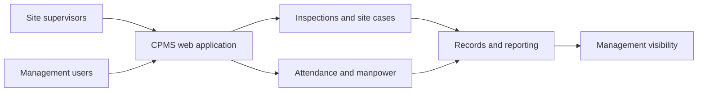

# CPMS — Contractor Performance Management System

**Domain:** Contractor oversight, site operations, inspections, and workforce reporting  
**Portfolio status:** Implemented web platform with documented deployment and operational controls; scope and adoption should be confirmed for any specific environment.

[← Back to portfolio](../README.md)

## Business challenge

Contractor management may span numerous project sites, manual inspections, attendance submissions, audit evidence, and recurring management reports. Disconnected records make follow-up, accountability, and visibility more difficult.

## Solution

CPMS brings site-level operational reporting into a role-aware platform, allowing supervisors and management to coordinate submissions, monitor exceptions, and maintain a structured audit trail.

### Documented capabilities

- Project, site, and contractor-related records
- Inspection forms, evidence collection, and audit submissions
- Site cases, feedback, and follow-up reporting
- Workforce registers, daily attendance, and manpower visibility
- Supervisor-controlled daily attendance with a reviewable history
- Analytics, management reports, and scheduled reporting
- Responsive, installable web-app experience
- Role-based access, session controls, and administrative multi-factor authentication

**Configuration note:** Optional GPS-geofencing and face-verification components exist in the application, but current project documentation states that **both attendance checks are disabled**. The operating attendance process relies on supervisor confirmation; it must not be described as currently location- or face-verified.

## High-level architecture

**Technology:** Next.js, React, TypeScript, PostgreSQL, responsive PWA patterns, and staged cloud/self-hosted deployment designs.

## Architecture and delivery decisions

- Scope users to assigned projects and sites, rather than trusting browser-visible filters.
- Prioritise supervisor-friendly workflows for field operations.
- Preserve submission and amendment histories for accountability.
- Keep optional location/biometric controls configuration-dependent, with privacy and operational trade-offs made explicit.
- Design the operational system for both management reporting and frontline data collection.

## Evidence and maturity

The private repository describes application modules, authentication and security architecture, operational attendance behaviour, and production service deployment scripts. This overview does not assert a specific customer rollout, workforce scale, or measured efficiency gain.

## Leadership perspective

Demonstrates field-operations digitisation, application governance, access-control design, workforce process analysis, and the translation of management requirements into repeatable operational workflows.

## Disclosure

No customer identity, actual employee records, attendance data, internal network details, operational screenshots, or source code are published here.
