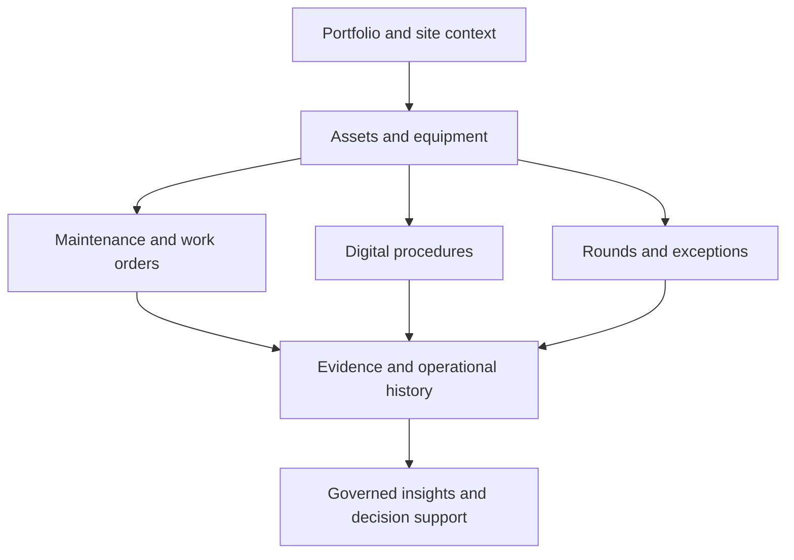

# DCDOT (UPTIVIS) — Data Center Digital Operations Twin

**Domain:** Mission-critical facilities, operational governance, and digital workflows  
**Portfolio status:** Phased platform development; production facility integrations and vendor interoperability are not claimed.

[← Back to portfolio](../README.md)

## Business challenge

Data center teams work across maintenance records, operating procedures, asset registers, digital rounds, incidents, and separate operational systems. Fragmented evidence and inconsistent handovers can make it harder to demonstrate operational control and reconstruct events.

## Solution vision

DCDOT (UPTIVIS) is a digital operations platform initiative designed to connect operational activities with a governed site-and-asset context. Its emphasis is **reliable execution, traceability, and human control**, rather than another isolated dashboard.

### Capabilities documented in the project

- Multi-tenant platform foundation with portfolio, site, and role-scoped access
- Asset-centric maintenance plans, work orders, field execution, and history
- Controlled digital SOP/MOP/EOP procedure workflows with evidence and approvals
- Digital rounds, manual readings, exceptions, corrective work, and shift handover
- Permission-aware, evidence-grounded AI Copilot foundations with draft-only actions
- An extensible architecture for separately validated operational integrations

**Current boundaries:** Live BMS/EPMS/DCIM interoperability must be validated for each customer and vendor. Do not infer active equipment control, production telemetry connectivity, predictive maintenance, or autonomous AI authority from this case study. Tested adapter fixtures are not customer UAT.

## High-level architecture

**Technology:** Next.js, React, TypeScript, Supabase/PostgreSQL, role-scoped data access, Vercel-compatible cloud deployment, and modular integration boundaries.

## Architecture and delivery decisions

- Model site, asset, and user-access relationships before layering on automation.
- Keep procedures and maintenance records linked to supporting evidence.
- Separate planned integration capability from validated live connectivity.
- Restrict AI to permission-aware assistance and draft suggestions; retain human authority for critical actions.
- Deliver in controlled epics with explicit acceptance and limitations.

## Evidence and maturity

The private project contains implementation notes, validation scripts, and documented functionality across multiple epics. External connector compatibility, production telemetry, and performance in customer facilities require separate validation.

## Leadership perspective

Demonstrates industry problem framing, mission-critical workflow architecture, data governance, safety boundaries, incremental delivery, and enterprise integration strategy.

## Disclosure

Source code, vendor-specific connector details, site data, and project test evidence remain private. This overview is not a vendor compatibility certification or operational safety approval.
