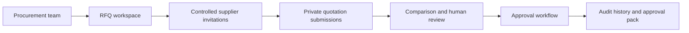

# Procure — Procurement Workflow Platform

**Domain:** Procurement digitisation, supplier collaboration, and controlled approvals  
**Portfolio status:** Working application with documented hosted acceptance for core workflows; not a claim of enterprise-wide rollout.

[← Back to portfolio](../README.md)

## Business challenge

Purchasing teams often manage quotations through email threads, spreadsheets, and detached documents. This makes it difficult to see which suppliers have responded, compare submissions consistently, and preserve an approval trail.

## Solution

Procure brings the request-for-quotation lifecycle into a single workflow: create an RFQ, invite suppliers, receive responses securely, compare available quotation details, and submit a human-justified selection for review.

### Implemented capabilities

- RFQ creation, supplier records, invitation and submission tracking
- Controlled supplier access and private quotation-document handling
- Email delivery tracking and manual/automated reminder mechanisms
- Supplier-entered commercial details and quotation comparison
- Human-led preferred-supplier selection and approval queue
- Approve, reject, return-for-clarification, and resubmission history
- Audit records and a downloadable approval summary pack
- Multi-organisation membership and role-based access restrictions

**AI boundary:** An optional AI-assisted extraction/comparison layer has been developed, but production AI processing is disabled. The approval workflow is designed to work without AI; it does not automatically recommend or approve a supplier.

## High-level architecture

**Technology:** Next.js, React, TypeScript, Supabase authentication/PostgreSQL/private storage, Vercel, transactional email, and PDF generation.

## Architecture and delivery decisions

- Keep supplier access distinct from authenticated internal access.
- Enforce organisation boundaries and workflow permissions at the data layer.
- Preserve historical approval attempts instead of overwriting decisions.
- Make human justification and review mandatory for approvals.
- Keep the core procurement workflow operational without an AI provider.

## Evidence and maturity

The project's internal documentation records hosted acceptance of RFQ submission and approval workflows using synthetic test data, as well as automated security and browser checks. These are engineering validation results, **not** evidence of customer adoption or quantified savings.

## Leadership perspective

Demonstrates requirements-to-product translation, workflow redesign, security-by-design, role separation, phased delivery, and pragmatic AI governance.

## Disclosure

The product repository, quotation documents, configuration, and operational evidence remain private. Any live demonstration requires appropriate access and sanitised data.
